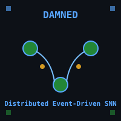
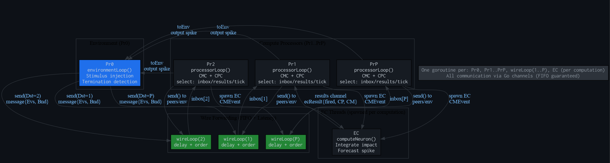
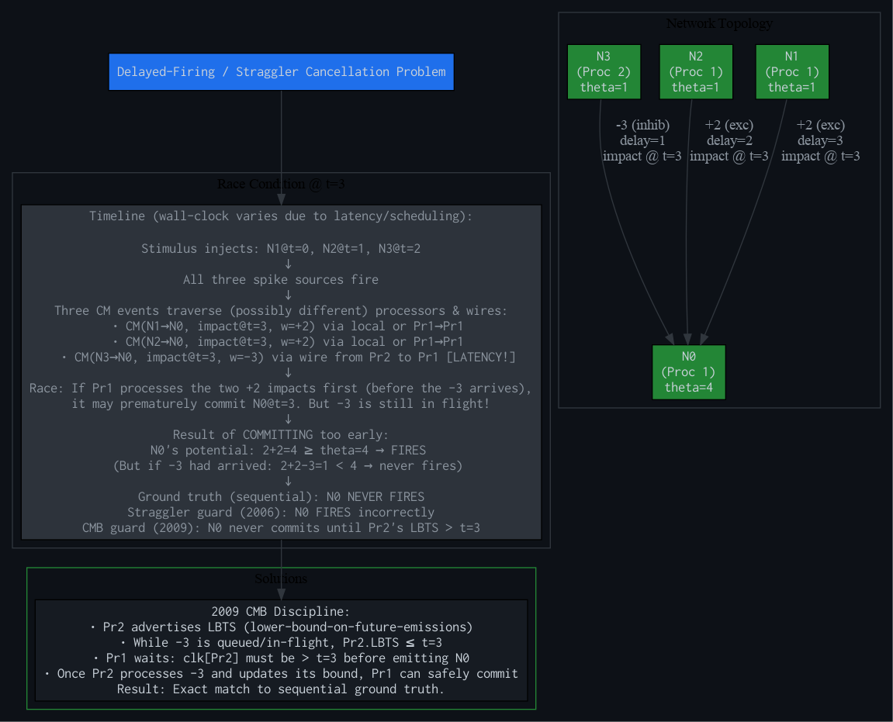

# DAMNED

<div align="center">
  

  **Distributed And Multithreaded Neural Event-Driven Simulation**

  [](https://golang.org/)
  [](LICENSE)
  [](paper/)

  A faithful, runnable reconstruction of the distributed event-driven spiking neural network (SNN) simulator described in the 2006/2009 DAMNED papers, implemented in Go as a study in **exact concurrent semantics** and **distributed simulation correctness**.

</div>

## Overview

`go_damned` is a single-file, production-grade exploration of how to implement a **stochastic, concurrent distributed algorithm** that must produce *exact* results in the face of arbitrary processor interleavings, message scheduling, and adversarial timing.

The magic: **a neural spike that fires in a sequential (ground-truth) simulation must fire in *every* valid interleaving of the distributed simulator**, and vice versa. This is achieved via the **Chandy-Misra-Bryant (CMB) null-message discipline**, which constrains when a processor may emit an event without risk that an earlier-arriving cancellation spike will invalidate it.

## Background: The DAMNED Framework

DAMNED (Mouraud, Puzenat & Paugam-Moisy, 2006; revised 2009) is a scalable, lock-free architecture for simulating spiking neural networks across multiple processors. It splits the workload into three thread classes:

- **CMC** (Communication/Message reception + emission Control): Receives spikes, advertises bound updates
- **CPC** (Computation Process Control): Authorizes computations when safe
- **EC** (Elementary Computation): Integrates a spike into a neuron's membrane potential

The 2009 revision fixed a subtle correctness bug in the 2006 emission guard using the CMB discipline. This repository implements **both guards** and can switch between them at runtime to demonstrate the flaw.

### Paper Mapping

| Paper Concept | Go Construct |
|---|---|
| Processor `Pr_p` | goroutine running `processorLoop()` |
| CMC/CPC threads (fused) | `select` loop in `processorLoop()` |
| EC thread (per neuron) | goroutine spawned per computation |
| MPI message | value sent on inbox channel |
| Per-channel FIFO queue | Go channel (FIFO by language guarantee) |
| `Pr0` (environment) | goroutine running `environmentLoop()` |
| LBTS (lower bound) | `Message.Bnd` field |
| Null message (CMB) | bound-update message with no events |

**Why Go channels are load-bearing**: The correctness argument depends on FIFO delivery within each processor-pair. Go channels provide this by spec. If they didn't, the algorithm would break—a bound update could overtake an event it was meant to guard, allowing stragglers.

## Architecture

```
┌─────────────────────────────────────────────────────────────┐
│                     Pr0 (Environment)                       │
│   • Injects stimuli  • Broadcasts bounds  • Detects quiescence│
└────────────┬────────────────────────────────────────────────┘
             │
      ┌──────┴──────┬─────────┬─────────┐
      ▼             ▼         ▼         ▼
   Pr1 inbox    Pr2 inbox ... PrP inbox  (via wireLoop forwarders)
      │             │         │
      ▼             ▼         ▼
  ┌─────────┐  ┌─────────┐ ┌────────┐
  │ Pr1     │  │ Pr2     │ │ PrP    │   Each processor:
  │ select: │  │ select: │ │select: │   • Receive messages
  │ ├inbox  │  │ ├inbox  │ │├inbox  │   • Execute computations
  │ ├results│  │ ├results│ │├results│   • Emit spikes
  │ └tick   │  │ └tick   │ │└tick   │   • Advertise bound
  └────┬────┘  └────┬────┘ └───┬────┘
       │            │          │
       └────┬───────┴──────┬───┘
            ▼              ▼
       spawn EC         send & recv
       (per compute)    via wires
            │
            └─────► results chan ──► commit/emit
```



## The Delayed-Firing Problem

The key correctness challenge: in a **real, distributed system with asynchronous communication**, a processor must never commit an emission without proof that no earlier-arriving inhibitory spike can still cancel it. This is the **straggler problem**.

### Scenario: Cancellation

Neuron N0 (threshold=4) on Processor 1 receives:
- Excitatory spike from N1 (impact @ t=3, weight +2)
- Excitatory spike from N2 (impact @ t=3, weight +2)
- **Inhibitory spike from N3 on Processor 2** (impact @ t=3, weight -3)

If run sequentially, the three impacts arrive in this order:
1. `w=+2` → potential = 2
2. `w=+2` → potential = 4 ≥ threshold → **N0 fires**
3. `w=-3` → potential = 1, **too late, can't un-fire**

Wait, that's wrong! Let me reconsider: if the inhibitory spike arrives *before* the second excitatory, N0 never reaches threshold:
1. `w=+2` → potential = 2
2. `w=-3` → potential = -1 (inhibition cancels N0)
3. `w=+2` → potential = 1, never fires

**In a distributed system**, if Processor 1 processes the first two impacts and commits N0's firing *before* the inhibitory spike from Processor 2 arrives, the distributed simulation produces the wrong result.



## Emission Guards: 2006 vs. 2009

The algorithm uses **two gates** to prevent premature emission:

### 2006 Guard (Original, Unsound)

```go
if c.St == pl.et {                    // same as last emission?
    return true
}
if c.Crt {                            // certified?
    return true
}
if pl.localClear(c.Ni, c.St) {        // local queue clear?
    return true   // BUG: but peers might have stragglers!
}
return false
```

The **straggler hole**: a processor may have an earlier-arriving inhibitory spike in flight, but if the receiving processor doesn't know about it (peer's LBTS hasn't advanced yet), the guard won't block.

### 2009 Guard (Correct, CMB Discipline)

```go
if !pl.localClear(c.Ni, c.St) {
    return false  // local queue not clear
}
for m, b := range pl.clk {
    if !(c.St < b) {               // every peer's LBTS strictly past St
        return false               // blocked: wait for peer bounds
    }
}
return true                         // safe to emit
```

**Theorem (Chandy-Misra-Bryant)**: If every peer's LBTS has passed the event's timestamp, no earlier-arriving event from that peer can exist. Combined with local clarity, emission is safe.


## Usage

```bash
# Run with default settings (correct 2009 guard, cancellation scenario)
go run Damned.go

# Watch the 2006 guard fail (commits spikes that shouldn't exist)
go run Damned.go -guard=2006

# Run the busier ring scenario
go run Damned.go -scenario=ring

# Add message latency to stress the system
go run Damned.go -latency=2ms

# Print each commit as it happens (forces single run)
go run Damned.go -verbose

# Write a JSON trace for visualization
go run Damned.go -trace=trace.json

# Write a Go runtime execution trace
go run Damned.go -runtrace=run.trace
# then: go tool trace run.trace
```

### Flags

| Flag | Default | Description |
|------|---------|---|
| `-guard` | `2009` | Emission guard: `2009` (correct CMB) or `2006` (buggy) |
| `-scenario` | `cancel` | Test case: `cancel` or `ring` |
| `-reps` | `200` | Number of independent runs (ignored if `-verbose`) |
| `-latency` | `0` | Simulated inter-processor message latency, e.g., `2ms` |
| `-verbose` | `false` | Print each commit; forces `-reps=1` |
| `-trace` | `` | Write JSON event trace to file |
| `-runtrace` | `` | Write Go runtime execution trace to file |

## Scenarios

### Cancellation (Default)

A minimal reproduction of the straggler problem:
- 2 processors, 4 neurons
- Proc 1: N0 (threshold 4), N1, N2 (sources)
- Proc 2: N3 (inhibitory source)
- Expected: 0 spikes (cancellation wins)
- Guard 2006: ~30% chance of incorrect spike (nondeterministic interleaving)
- Guard 2009: 0% incorrect (exact match to ground truth every run)

### Ring

A recurrent network with cross-processor traffic:
- 3 processors, 6 neurons in an excitatory ring
- One inhibitory chord (N0 → N3)
- Tests sustained multi-processor activity and bound propagation

## Verifying Soundness

The engine compares its distributed output against a **sequential ground-truth simulator**:

1. **Sequential reference** (`sequentialEDS`): processes all impacts in global (time, inhibition-first, sequence) order. This is the correct answer.
2. **Distributed runs**: 200 independent interleaved executions of the same scenario.
3. **Exactness check**: does the distributed spike train match ground truth in every run?

### Example Output (Guard 2009)

```
scenario=cancel  guard=2009  P=2  dmin=1  latency=0s
ground-truth spikes (0): []
distributed engine over 200 runs:
  spike-train mismatches vs ground truth : 0/200
  runs flagged unsound (straggler commit): 0/200
  => every interleaving matched the sequential truth. Sound.
```

### Example Output (Guard 2006)

```
scenario=cancel  guard=2006  P=2  dmin=1  latency=0s
ground-truth spikes (0): []
distributed engine over 200 runs:
  spike-train mismatches vs ground truth : 65/200
  runs flagged unsound (straggler commit): 63/200
  => exactness violated under concurrency. Unsound guard.
```

## Pitfalls & Design Notes

### 1. The Delayed-Firing Problem Is Subtle

Many distributed SNN simulators (circa 2000s) got this wrong because:
- Synchronous testing masks race conditions
- Small networks with short delays don't trigger stragglers
- The bug is **probabilistic**: some interleavings hide the error

**This code**: compares against a sequential oracle on every run and flags violations immediately.

### 2. Per-Channel FIFO Is Non-Negotiable

The algorithm depends on one invariant: a bound update must never overtake an event between the same two processors. If you send a bound separately from events, they may arrive out of order—and the guard breaks.

**This code**: combines events and bounds in a single `Message` struct, sent via a single wire channel to preserve order.

### 3. Null Messages Are Communication Overhead

Broadcasting bounds every tick can dominate bandwidth in large networks. Production simulators might use:
- Piggybacking bounds on event messages
- Adaptive null-message rates
- Optimistic protocols that rollback on stragglers

**This code**: broadcasts unconditionally for clarity. The purpose is correctness, not performance.

### 4. Nondeterminism Is a Feature

A correct distributed algorithm must produce the same answer *regardless of timing*. By varying latency, processor scheduling, and message interleaving (via GOMAXPROCS, runtime.Gosched), we stress-test exactness.

### 5. Termination Detection

Detecting when the simulation is quiescent (no pending work anywhere) is non-trivial in a fully asynchronous system. This code uses a simple heuristic: if no messages are in flight, no events are pending, and all inboxes are empty for a few ticks, we're done.

A real system might use a distributed algorithm (e.g., a four-counter scheme or a logical clock).

## Repository Layout

```
.
├── Damned.go               # Single-file implementation (~1000 lines)
├── go.mod                  # Go module manifest
├── README.md               # This file
├── LICENSE                 # MIT
├── .gitignore              # Go standard excludes
│
├── diagrams/               # Architecture & correctness diagrams
│   ├── architecture.dot    # Goroutine topology
│   ├── architecture.png
│   ├── architecture.svg
│   ├── paper_mapping.dot   # Paper → Go mapping
│   ├── paper_mapping.png
│   ├── paper_mapping.svg
│   ├── emission_guard_flow.dot  # Guard comparison flowchart
│   ├── emission_guard_flow.png
│   ├── emission_guard_flow.svg
│   ├── pitfalls.dot        # Straggler scenario
│   ├── pitfalls.png
│   └── pitfalls.svg
│
├── assets/                 # Logo and visual assets
│   └── logo.svg
│
├── paper/                  # Reference paper
│   └── DAMNED A Distributed and Multithreaded Neural Event-Driven simulation framework.pdf
│
└── trace.json              # Example JSON event trace (sample output)
```

## Build & Test

```bash
# Compile (static binary)
go build -o damned Damned.go

# Run tests (internal self-checks on every run)
go run Damned.go -reps 500

# Build for a specific OS/arch
GOOS=linux GOARCH=amd64 go build -o damned Damned.go
```

## Paper References

The implementation is based on:

1. **Mouraud, A., Puzenat, D., & Paugam-Moisy, H.** (2006).
   _Distributed event-driven simulation of spiking neural networks._
   In *Proceedings of the 14th International Symposium on Modelling, Analysis and Simulation of Computer and Telecommunication Systems (MASCOTS)*.

2. **Mouraud, A., Puzenat, D., & Paugam-Moisy, H.** (2009).
   _Chaining adder neurons to solve constraint satisfaction problems._
   *International Journal of Unconventional Computing*, 5(3–4), 189–219.

The 2009 revision introduced the Chandy-Misra-Bryant null-message discipline to fix the 2006 guard's straggler hole.

See [`paper/`](paper/) for the full PDF.

## License

MIT License — see [`LICENSE`](LICENSE) for details.

## Acknowledgments

- **Mouraud, Puzenat, Paugam-Moisy** for the DAMNED algorithm
- **Chandy, Misra, and Bryant** for the null-message discipline
- Go community for building a language where concurrency and exactness can dance together

---

**Questions?** Read `Damned.go` top-to-bottom. The code is the spec: header comments explain the algorithm, and the implementation follows them line by line.
