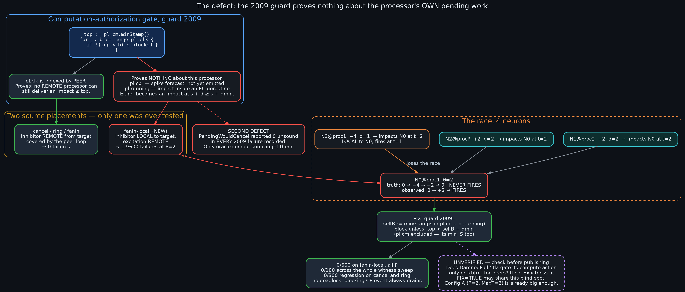
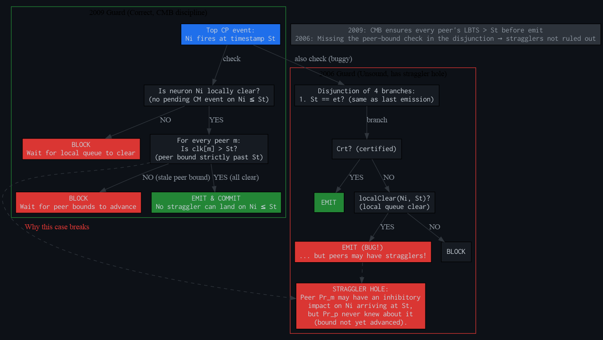

# DAMNED

<div align="center">
  

  **Distributed And Multithreaded Neural Event-Driven Simulation**

  [](https://golang.org/)
  [](LICENSE)
  [](#references)
  [](https://github.com/danindiana/go_damned/actions/workflows/ci.yml)

  A runnable reconstruction, in Go, of the event-driven spiking neural network (SNN) simulator described in the 2006 and 2009 DAMNED papers, used to test whether its synchronization guards produce exactly the spikes a sequential simulation would.

</div>

## Overview

DAMNED (Mouraud, Puzenat and Paugam-Moisy) simulates spiking neural networks across many processors with no central controller. Each processor decides on its own when it is safe to compute and emit a spike, using lower bounds on what its peers may still send. If that decision is wrong, a spike can be committed that an earlier inhibitory spike should have cancelled, and the simulation silently diverges from the correct answer.

`go_damned` runs the algorithm with one goroutine per processor, then compares every run's spike train against a sequential reference simulation. It is a **single-process concurrent simulator**: goroutines and channels emulate processors and links. It is not a distributed runtime.

## At a glance

- **Both published guards let wrong spikes through.** The 2006 guard misses late spikes from other processors. The 2009 guard, as reconstructed here, misses late spikes from the processor's own pending work.
- **A corrected guard, `2009L`, has produced no wrong spike in any check:** hand-built scenarios, 8,000 random networks in Go, and every possible interleaving of 125 small networks in a TLA+ model. That is strong evidence, not yet a proof for all networks.
- **Whether the 2009 paper itself has the bug depends on two details of notation** that the available text cannot settle. Under the one reading that works, the paper's rule is `2009L` for one-event-at-a-time processing.
- **It matters most on fast on-chip interconnects:** link latency hides the 2009 defect, and low latency exposes it.

Every push is checked automatically (`go vet`, `go test`, the race detector, and TLC on the named networks).

## Findings

1. **The 2006 guard is unsound.** Reproduced: it commits spikes that should have been cancelled (`cancel`: 156 of 300 runs wrong on 2026-11-24).
2. **The 2009 guard, as reconstructed here, is also unsound.** Its computation gate checks only *peer* bounds and never this processor's own un-emitted spikes. A four-neuron counterexample (`fanin-local`: inhibitor on the same processor as its target, excitation remote) produces a spike the sequential simulation does not. The late local impact can also be excitatory, giving a spike at the wrong time or a duplicate: of 41 failures in a random search, 39 involved a local inhibitory synapse and 2 only a local excitatory one. Details: [`docs/DEFECT-local-straggler.md`](docs/DEFECT-local-straggler.md).
3. **A corrected guard, `2009L`, adds the missing local bound.** It has had zero wrong runs in every test: the hand-built scenarios, 0 of 8,000 random networks in Go (where `2009` failed on 39), and no violation or deadlock over every interleaving of 5 named and 120 random networks in TLA+ (where `2009` failed on 4). That is strong evidence, not a proof for all networks. Details: [`docs/VERIFICATION-2009L.md`](docs/VERIFICATION-2009L.md).
4. **The built-in soundness flag misses this class of error.** It reported 0 in every `2009` failure. The spike-train comparison against the sequential simulation caught all of them, so that comparison is the correctness criterion here.
5. **The original TLA+ model cannot see it; a new one can.** The original model's 2009 gate has the same blind spot, its exactness invariant is the same commit-time check as the flag, and it has no synaptic weights ([defect report, section 7](docs/DEFECT-local-straggler.md#7-consequences-for-the-tla-model)). A new model with real neurons, in [`formal-verification/weighted/`](formal-verification/weighted/), finds the 2009 failure, including when each processor computes one event at a time as the 2009 paper describes, and finds no violation under `2009L`.
6. **Low latency exposes the defect; latency hides it.** With 1 ms of simulated link latency, `2009` passes `fanin-local` in 300 of 300 runs; with none it fails. Tightly coupled, low-latency interconnects (an on-chip mesh rather than an MPI cluster) are therefore the regime where this matters most.
7. **A fixed-size spiking network computes an NC¹-complete function.** The `word` scenario tracks products in the symmetric group S5 (its word problem is NC¹-complete, by Barrington's theorem) with 364 neurons and 1,080 synapses at every word length, and depth 2n. Under `2009L` it returned the correct product in every run, up to n = 64 (rerun after today's fixes). Under `2009` it returned the wrong product in up to 44% of runs. Details: [`docs/WITNESS_REPORT.md`](docs/WITNESS_REPORT.md).
8. **An accounting leak hung the engine on dense networks.** In-flight messages were decremented once per message but incremented once per event. Fixed.
9. **Equal-time order was under-specified.** A neuron resets when it fires, so two excitatory impacts at the same stamp do not commute. The paper fixes only inhibitory-before-excitatory. Both the reference and the engine now break ties by source neuron; `2009L` guarantees every same-stamp impact has arrived before the first is integrated, so the engine can always honour that order ([verification report, section 2.1](docs/VERIFICATION-2009L.md#21-equal-time-order-a-gap-in-the-specification-now-closed)).
10. **The published rule holds only under one reading.** Model-checking the 2009 paper's processing rule in each plausible reading: it is correct only if the task's own clock is part of the check and its printed `≤` behaves as a strict `<`, in which case it is `2009L` for one-event-at-a-time processing. Taken at face value, `≤` lets late spikes through even from other processors. Which reading the authors meant cannot be settled from the extracted text ([report, section 1.1](docs/VERIFICATION-2009L.md#11-model-checking-the-papers-rule-roadmap-12)).

## Results

### Verifying 2009L

| Check | Orderings covered | `2009` | `2009L` |
|---|---|---|---|
| Random networks, Go engine (8,000 networks × 15 runs) | sampled | 39 diverged | 0 diverged |
| TLA+, 5 named networks, concurrent and one at a time | every interleaving | wrong spike in 3 | no violation, no deadlock |
| TLA+, 120 random networks, concurrent and one at a time | every interleaving | wrong spike in 1 | no violation, no deadlock |
| S5 witness, n = 64 (50 runs) | sampled | not rerun | 0 wrong |

The paper's own rule, model-checked in three readings over the same networks, is in [verification report, section 1.1](docs/VERIFICATION-2009L.md#11-model-checking-the-papers-rule-roadmap-12): as printed (`≤`), it gave wrong spikes in 6 and 4 of the 120 random networks and even in the remote-inhibitor `cancel` network; only with the processor's own clock included and a strict `<` did it give none. The same results as diagrams: [`diagrams/2026-11-24-verification/`](diagrams/2026-11-24-verification/).

### Hand-built scenarios, 2026-11-24

Wrong runs out of the total, latency 0. Full output: [`docs/results/2026-11-24-sweep.txt`](docs/results/2026-11-24-sweep.txt). These runs predate the equal-time order fix, which changes no verdict here.

| Scenario | 2006 | 2009 | 2009L |
|---|---|---|---|
| `cancel` (inhibitor remote, P = 2) | 156/300 | 0/300 | 0/300 |
| `ring` (P = 3) | 8/300 | 0/300 | 0/300 |
| `fanin-local`, P = 2 | 12/600 | **348/600** | 0/600 |
| `fanin-local`, P = 3 | 79/600 | 2/600 | 0/600 |
| `fanin-local`, P = 4 | 206/600 | 2/600 | 0/600 |
| `word`, S5, n = 32 (wrong product) | not run | 27/100 | 0/100 |
| `word`, Z120 control, n = 32 (wrong product) | not run | 18/100 | 0/100 |

Failure counts under the unsound guards depend on goroutine scheduling and vary a lot between runs and machines (`fanin-local` under `2009` at P = 2 gave 17/600 on 2026-09-05). Quote them as "fails", not as rates. The zeros under `2009L` have held in every run.

## Architecture

```
┌─────────────────────────────────────────────────────────────┐
│                     Pr0 (Environment)                       │
│   • Injects stimuli  • Broadcasts bounds  • Detects quiescence│
└────────────┬────────────────────────────────────────────────┘
             │
      ┌──────┴──────┬─────────┬─────────┐
      ▼             ▼         ▼         ▼
   Pr1 inbox    Pr2 inbox ... PrP inbox  (via wireLoop forwarders)
      │             │         │
      ▼             ▼         ▼
  ┌─────────┐  ┌─────────┐ ┌────────┐
  │ Pr1     │  │ Pr2     │ │ PrP    │   Each processor:
  │ select: │  │ select: │ │select: │   • Receive messages
  │ ├inbox  │  │ ├inbox  │ │├inbox  │   • Execute computations
  │ ├results│  │ ├results│ │├results│   • Emit spikes
  │ └tick   │  │ └tick   │ │└tick   │   • Advertise bound
  └────┬────┘  └────┬────┘ └───┬────┘
       │            │          │
       └────┬───────┴──────┬───┘
            ▼              ▼
       spawn EC         send & recv
       (per compute)    via wires
            │
            └─────► results chan ──► commit/emit
```


| Paper concept | Go construct |
|---|---|
| Processor `Pr_p` | goroutine running `processorLoop()` |
| CMC/CPC threads (fused) | `select` loop in `processorLoop()` |
| EC thread (per neuron) | goroutine spawned per computation |
| MPI message | value sent on an inbox channel |
| Per-channel FIFO queue | Go channel (FIFO by language guarantee) |
| `Pr0` (environment) | goroutine running `environmentLoop()` |
| Lower bound on future emissions (LBTS) | `Message.Bnd` field |
| Null message (Chandy–Misra–Bryant) | bound-update message with no events |

**Why Go channels are load-bearing.** The correctness argument depends on FIFO delivery between each pair of processors. Go channels provide this by specification. Without it, a bound update could overtake the event it was meant to guard.

## The delayed-firing problem

In an event-driven SNN, an inhibitory spike with a short delay can cancel a spike that was already forecast. A distributed simulator must therefore never commit a spike until it is certain that no earlier-arriving impact can still change the outcome. An event that arrives after the decision it should have changed is a **straggler**.

At equal timestamps, the sequential reference applies inhibitory impacts before excitatory ones, and impacts of the same sign in order of source neuron.

### The `cancel` scenario

Neuron N0 (threshold 4) on processor 1 receives three impacts, all at t = 3:

- +2 from N1 (processor 1, delay 3, stimulated at t = 0)
- +2 from N2 (processor 1, delay 2, stimulated at t = 1)
- −3 from N3 (processor 2, delay 1, stimulated at t = 2)

Sequentially, the inhibition comes first: 0 → −3 → −1 → +1. N0 stays below threshold and never fires.

A distributed run goes wrong if processor 1 integrates the two excitatory impacts (0 → +2 → +4, so N0 fires) before the inhibitory impact from processor 2 has arrived. The 2006 guard allows this.


### The `fanin-local` scenario (mirror image)

Neuron N0 (threshold 2) on processor 1 receives three impacts at t = 2: +2 from N1 and +2 from N2 (both on other processors), and −4 from N3, which is on **the same processor as N0** and fires at t = 1. Sequentially: 0 → −4 → −2 → 0, so N0 never fires. Under the `2009` guard, processor 1 can integrate the two remote +2 impacts before its own N3 spike has been emitted, so N0 fires.



## Guards: 2006, 2009 and 2009L

Each guard has two gates: one deciding when a processor may **compute** (integrate the next impact), and one deciding when it may **emit** a forecast spike.

### 2006 (original, unsound)

The emission gate admits a spike if any of several conditions holds. Three of them silently assume that no straggler exists:

```go
if c.St == pl.et { return true }          // same as last emission
if c.Crt { return true }                  // certified
if pl.localClear(c.Ni, c.St) {            // nothing local pending
    return true                           // but a peer may still hold a straggler
}
return false
```

### 2009 (revision, unsound locally)

The 2009 revision adopts the Chandy–Misra–Bryant discipline. Emission requires the local queue to be clear and every peer's bound to be strictly past the spike's stamp:

```go
if !pl.localClear(c.Ni, c.St) { return false }
for _, b := range pl.clk {
    if !(c.St < b) { return false }      // wait for every peer's bound
}
return true
```

Its computation gate checks only peer bounds:

```go
top := pl.cm.minStamp()
for _, b := range pl.clk {               // pl.clk holds PEER bounds only
    if !(top < b) { ok = false; break }
}
```

This proves no *remote* processor can still deliver an earlier impact. It says nothing about spikes this processor has forecast but not yet emitted, or about computations still running locally. Either can produce an impact on a local neuron at `s + d ≥ s + dmin`.

### 2009L (2009 plus the local bound)

```go
selfB := INF
for _, c := range pl.cp      { if c.St < selfB { selfB = c.St } }   // forecast, not yet emitted
for _, r := range pl.running { if r.St < selfB { selfB = r.St } }   // still computing
if selfB < INF && !(top < selfB + e.dmin) { ok = false }
```

The blocking forecast can always drain, so this cannot deadlock (argument in the [defect report, section 4](docs/DEFECT-local-straggler.md#4-fix)).

### The paper's own rule (model only)

The TLA+ model also has the 2009 paper's processing rule (Algorithm 3) in three readings, `2009P1` to `2009P3`, because the extracted text leaves two details open: whether the check includes the processor's own clock, and whether its printed `≤` is meant as `<`. These guards exist only in the model, not in the Go engine. See [verification report, section 1.1](docs/VERIFICATION-2009L.md#11-model-checking-the-papers-rule-roadmap-12).



## Usage

```bash
go build -o damned .

./damned                                   # cancel scenario, 2009L guard
./damned -guard=2006                       # watch the 2006 guard fail
./damned -scenario=fanin-local -procs=2 -guard=2009 -reps=600    # the 2009 defect
./damned -scenario=fanin-local -procs=2 -guard=2009L -reps=600   # the fix
./damned -scenario=word -group=s5 -len=32 -words=5 -reps=20 -procs=3 -guard=2009L
./damned -latency=2ms                      # add simulated link latency
./damned -verbose                          # print each commit (one run)
./damned -trace=trace.json                 # JSON trace for examples/viz.html
./damned -runtrace=run.trace               # Go runtime trace; open with: go tool trace run.trace

go test -v .                               # 2009L checks plus a 400-network random search (~1 min)
go test -race -run 'Test(Cancel|Ring|FaninLocal|WordWitness|WordSize|EqualStamp)' .
```

The tests check that `2009L` matches the sequential reference on the hand-built scenarios and 400 random networks, and that the S5 network computes the right product at a fixed size. They do not assert that `2006` or `2009` fail, since that depends on scheduling; run the binary for those.

Longer checks:

```bash
# Random search, 8,000 networks per guard (~35 min)
FUZZ_CASES=8000 FUZZ_REPS=15 FUZZ_SEED=11 go test -run TestFuzz -v -timeout 4h .

# Shrink and classify every 2009 failure (~20 min)
FUZZ_CLASSIFY=1 FUZZ_CASES=8000 FUZZ_REPS=15 FUZZ_SEED=11 go test -run TestFuzzClassify2009 -v -timeout 4h .

# Model-check with TLC (needs Java and tla2tools.jar)
cd formal-verification/weighted
python3 gen.py && ./run_tlc.sh /path/to/tla2tools.jar .              # named networks, every guard
python3 gen.py --random 120 2026 && ./run_tlc.sh /path/to/tla2tools.jar random
```

### Flags

| Flag | Default | Description |
|---|---|---|
| `-guard` | `2009L` | `2006`, `2009` or `2009L` |
| `-scenario` | `cancel` | `cancel`, `ring`, `fanin`, `fanin-local` or `word` |
| `-procs` | `3` | Processor count for `word`, `fanin` and `fanin-local` |
| `-group` | `s5` | Group for `word`: `s5` or `z120` (also `s3`, `s4`, `z6`, `z24`) |
| `-len` | `8` | Word length n for `word` |
| `-words` | `5` | Distinct random words for `word` |
| `-reps` | `200` | Runs per configuration (ignored with `-verbose`) |
| `-latency` | `0` | Simulated inter-processor latency, e.g. `2ms` |
| `-verbose` | `false` | Print each commit; forces one run |
| `-trace` | | Write a JSON event trace of one run |
| `-runtrace` | | Write a Go runtime execution trace |

## Scenarios

| Scenario | Shape | What it tests |
|---|---|---|
| `cancel` | 4 neurons, 2 processors; inhibitor remote from its target | The 2006 straggler |
| `ring` | 6-neuron excitatory ring over 3 processors, one inhibitory chord | Sustained cross-processor traffic |
| `fanin` | Like `cancel`, but all three sources remote from the target | Remote fan-in |
| `fanin-local` | Inhibitor on the target's processor, excitation remote | The 2009 local straggler |
| `word` | S5 or Z120 word problem; 364 neurons, 1,080 synapses at any length | Correctness at scale; the NC¹ witness |

## Checking correctness

1. **Sequential reference** (`sequentialEDS`): applies every impact in global order of time, then inhibition before excitation, then source neuron (stimuli first). This defines the correct spike train.
2. **Distributed runs**: many independent runs of the same scenario, each with its own goroutine interleaving.
3. **Exactness**: each run's committed spike train must equal the reference. For `word`, the decoded group element is also checked against a direct group-theoretic computation.

The engine also reports `flagged-unsound`, from `PendingWouldCancel`, which checks at each commit whether an impact on that neuron is still pending. It is a diagnostic hint, not a correctness test: it reported 0 in every `2009` failure.

Example (`2006` guard, a separate run from the table above):

```
scenario=cancel  guard=2006  P=2  dmin=1  latency=0s
ground-truth spikes (3): [[0 1] [1 2] [2 3]]
distributed engine over 300 runs:
  spike-train mismatches vs ground truth : 164/300
  runs flagged unsound (straggler commit): 59/300
  example divergent train: [[0 1] [1 2] [2 3] [3 0]]
  => exactness violated under concurrency. Unsound guard.
```

Spikes are listed as `[time neuron]`. In `cancel` only the three stimulated sources should fire; the divergent train also has N0 firing at t = 3. The soundness flag fired in 59 runs, fewer than the 164 wrong ones.

## Design notes

1. **The bugs are probabilistic.** Some interleavings hide them, and small networks with short delays rarely trigger them. This code compares against the sequential reference on every run.
2. **Per-channel FIFO is non-negotiable.** A bound update must never overtake an event between the same two processors. Events and bounds travel together in one `Message` on one channel. Any port to other hardware has to confirm that its interconnect gives per-pair ordering, or add sequence numbers.
3. **Null messages cost bandwidth.** Bounds are broadcast every tick here, for clarity. Real systems piggyback bounds on events, adapt the rate, or use optimistic protocols with rollback.
4. **A correct algorithm gives the same answer whatever the timing.** Varying latency, scheduling and interleaving is the test.
5. **Termination detection is a heuristic.** The run ends when no messages are in flight, no events are pending and all inboxes have been empty for a few ticks. A real system needs a distributed termination algorithm.
6. **Test both source placements.** The 2006 bug shows up when the inhibitor is remote from its target, the 2009 bug when it is local. The original scenarios only tried the first.

## Repository layout

```
.
├── Damned.go               # engine, guards, sequential reference, cancel/ring scenarios
├── fanin.go                # fanin and fanin-local scenarios
├── witness_group.go        # S5/Z120 word-problem network and driver
├── damned_test.go          # go test: 2009L exactness and witness checks
├── fuzz_test.go            # go test: random-network search, shrinking, failure classifier
├── go.mod
├── .github/workflows/ci.yml        # vet, tests, race detector, TLC on every push
├── docs/
│   ├── DEFECT-local-straggler.md   # the 2009 defect, counterexample and fix
│   ├── VERIFICATION-2009L.md       # paper reading, random search, model checking
│   ├── WITNESS_REPORT.md           # the word-problem witness
│   ├── results/                    # raw output: sweeps, n = 64 rerun, failure classification
│   └── diagrams/witness/           # 2026-09-05 witness and defect diagrams
├── diagrams/               # architecture and guard diagrams
│   └── 2026-11-24-verification/  # how 2009L was checked (9 diagrams)
├── analysis/               # diagrams 01-07, 12-13: how the algorithm works
├── proofs/                 # diagrams 08-11: correctness argument for 2006 vs 2009
├── formal-verification/    # TLA+ model (DamnedFull2.tla) and TLC results
│   └── weighted/           # TLA+ model with real neurons: guards 2009, 2009L and the
│                           #   paper readings 2009P1-P3; generator, runner, results
├── reference/              # earlier TLA+ models and Python reference
├── examples/               # earlier single-file version, sample traces, viz.html
├── notes/2026-09-05/       # archived working notes
├── paper/                  # the 2006 DAMNED paper (PDF)
└── assets/                 # logo
```

The proofs and formal-verification folders predate the `2009` defect; each has a note at the top saying what it does and does not establish.

## Roadmap

Ordered so that each phase rests on the one before it: correctness first, because the hardware this is aimed at (a low-latency on-chip mesh) is exactly where the `2009` defect shows up. No dates are attached; status reflects 2026-11-24.

### Phase 1: settle correctness

| # | Step | Why | Status |
|---|---|---|---|
| 1.1 | Classify every `2009` failure from the long random search by shape | The claim that every failure is a local inhibitor rested only on the cases examined | **Done 2026-11-24:** all 41 need a local synapse; 39 a local inhibitory one, 2 only a local excitatory one. The defect is any late local impact ([report, section 2.2](docs/VERIFICATION-2009L.md#22-classifying-every-2009-failure)) |
| 1.2 | Model the 2009 paper's processing rule (Algorithm 3) in every plausible reading and run the checks against each | Settles whether the defect is in the published algorithm or only in this reconstruction | **Done 2026-11-24** in the TLA+ model: the rule is correct only if it includes the task's own clock *and* its printed `≤` acts as a strict `<`; then it equals `2009L` one event at a time ([report, section 1.1](docs/VERIFICATION-2009L.md#11-model-checking-the-papers-rule-roadmap-12)). Open: confirm both details against the printed page |
| 1.3 | Extend the TLA+ model: stimuli arriving over time from Pr0, channels larger than 3 messages, liveness under fairness | Removes the three main simplifications behind the current TLC results | Open |
| 1.4 | Prove `2009L` sound for all networks | Every result so far covers specific networks; a proof covers all of them. Either an inductive invariant checked with TLAPS or Apalache, or a written proof that nothing can arrive below the gate's horizon | Open |
| 1.5 | Replace or remove the `flagged-unsound` diagnostic | It reported 0 in every `2009` failure; spike-train comparison is the real test | Open |
| 1.6 | Continuous integration: `go vet`, `go test -race` and TLC on the named networks on every push | Keeps the `2009L` results from regressing silently | **Added 2026-11-24** (`.github/workflows/ci.yml`) |

### Phase 2: make the engine usable beyond tests

| # | Step | Why | Status |
|---|---|---|---|
| 2.1 | Distributed termination detection in place of the current heuristic | The heuristic relies on global counters a real distributed runtime does not have (design note 5) | Open |
| 2.2 | Measure null-message traffic, then piggyback bounds on events or adapt their rate | Bounds are broadcast every tick for clarity; that cost grows with processor count (design note 3) | Open |
| 2.3 | Scale tests: larger networks and more processors, still checked against `sequentialEDS` | Current checks use at most 6 neurons (random search) and 364 neurons (S5 witness) | Open |

### Phase 3: the computation witness

From the [witness report, section 9](docs/WITNESS_REPORT.md#9-next).

| # | Step | Why | Status |
|---|---|---|---|
| 3.1 | Rerun the S5 and Z120 witness at n = 64 under `2009L` with the equal-time fix | n = 64 was last run on 2026-09-05, before the fix | **Done 2026-11-24:** 0/50 wrong for both groups ([output](docs/results/2026-11-24-n64.txt)) |
| 3.2 | Sweep `dmin` | Measures serialization cost against lookahead; all delays are currently 1 | Open |
| 3.3 | Add an A5 versus S4 control pair | Confirms the resource profile tracks group size and generator count, not solvability | Open |
| 3.4 | Composition witness | Still open | Open |

### Phase 4: Tenstorrent Blackhole

| # | Step | Why | Status |
|---|---|---|---|
| 4.1 | Confirm whether the Blackhole network-on-chip delivers messages between a pair of cores in order, including multicast | The algorithm requires per-pair FIFO (design note 2). If it is not guaranteed, add sequence numbers per link. Unverified | Question raised with Tenstorrent |
| 4.2 | Map processors to Tensix cores, with event queues and bounds in on-core memory and the `2009L` gate in the kernel | The low-latency regime is where `2009` fails, so the port starts from `2009L` | Blocked on hardware access |
| 4.3 | Check on-chip runs with the same reference: spike-train equality against `sequentialEDS` | Correctness on hardware has to be shown the same way as here, not assumed from it | Blocked on 4.2 |
| 4.4 | Compare throughput and latency with the Go engine | Shows whether the port is worth having | Blocked on 4.2 |

The [open-questions diagram](diagrams/2026-11-24-verification/08_open_questions.png) shows how phases 1 and 4 depend on each other.

## References

1. A. Mouraud, D. Puzenat and H. Paugam-Moisy. *DAMNED: A Distributed and Multithreaded Neural Event-Driven simulation framework.* arXiv:cs/0512018, 2005 (v2, March 2006). <https://arxiv.org/abs/cs/0512018>. This is the paper in [`paper/`](paper/) and the source of the `2006` guard.
2. A. Mouraud and D. Puzenat. *Simulation of Large Spiking Neural Networks on Distributed Architectures, The "DAMNED" Simulator.* In *Engineering Applications of Neural Networks* (EANN 2009), Springer, 2009. doi:[10.1007/978-3-642-03969-0_33](https://doi.org/10.1007/978-3-642-03969-0_33). The source of the `2009` revision.
3. K. M. Chandy and J. Misra. *Distributed Simulation: A Case Study in Design and Verification of Distributed Programs.* IEEE Transactions on Software Engineering, SE-5(5), 1979; R. E. Bryant, *Simulation of Packet Communication Architecture Computer Systems*, MIT LCS TR-188, 1977. The null-message discipline.
4. D. A. M. Barrington. *Bounded-width polynomial-size branching programs recognize exactly those languages in NC¹.* STOC 1986. The basis of the `word` witness.

An earlier version of this README cited the 2009 revision as *"Chaining adder neurons to solve constraint satisfaction problems."* That attribution was wrong; reference 2 is the 2009 DAMNED paper.

## License

MIT. See [`LICENSE`](LICENSE).

## Acknowledgments

Mouraud, Puzenat and Paugam-Moisy for the DAMNED algorithm; Chandy, Misra and Bryant for the null-message discipline.
